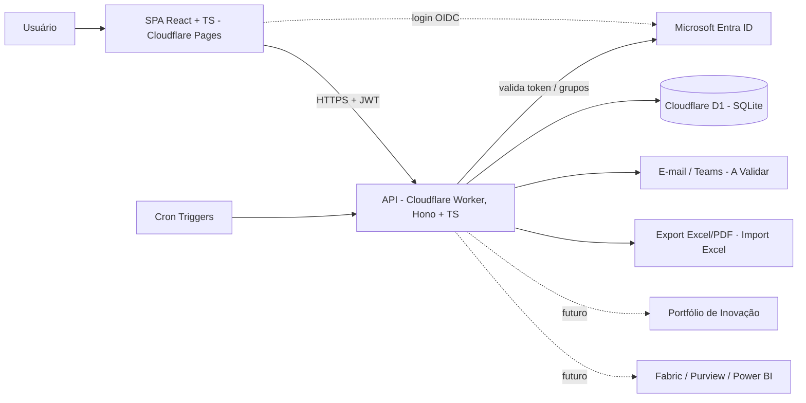

# J. Mendes DataMap — Análise da Documentação e Arquitetura Inicial

> **Arquivo START do projeto.** Em nova conversa, carregue este arquivo primeiro.
> Versão: 0.2 (Cloudflare) · Data: 26/11/2026 · Status: **aguardando validação** (nenhuma implementação iniciada)

---

## 1. Fontes analisadas

| Documento | Conteúdo útil |
|---|---|
| **TAP** – Programa de Gestão de Portfólio de Dados V1 | Objetivos, escopo, objetos a mapear (4.3), ondas/roadmap de 8 meses, capacidades da plataforma por versão (MVP/V1/V2), gates, riscos, papéis, priorização (Anexo A) |
| **BRD** – Programa de Gestão de Portfólio de Dados V1 | Entidades, 8 módulos funcionais (RF/RN/critérios de aceite), RNFs, navegação, critérios de sucesso, visão de produto |
| **Roteiro de Entrevistas RH** | Fichas de registro por ativo (conteúdo mínimo), fases, escopo do piloto, classificação (criticidade, confidencialidade, LGPD, qualidade) |

Não há na pasta: modelo de coleta em Excel, lista real de indicadores/sistemas do RH, desenho de infraestrutura, nem repositório Git.

## 2. Contexto de negócio (resumo)

- **Problema:** ativos de informação dispersos (sistemas, Excel, Power BI, conhecimento tácito); dependência de pessoas; indicadores divergentes entre áreas; custo alto para BI/automação/IA.
- **Solução:** catálogo vivo de **metadados** (não de conteúdo/dados pessoais) com workflow, histórico, recertificação e backlog de oportunidades.
- **Cadência:** Onda 1 piloto RH (90 dias, MVP testável na semana 8) → Onda 2 Comercial + Custos/Controladoria → até 2 ondas adicionais. V1 até mês 5, V2 até mês 7.
- **Stack:** TAP indica React + Node.js; **decisão de 26/11/2026: infraestrutura Cloudflare** (Pages + Workers + D1), mantendo React + TypeScript. **Auth:** Microsoft Entra ID. **Equipe:** Felipe Sauter (compartilhada com Portfólio de Inovação e IA até 21/04/2027 → risco de capacidade).
- **Meta de UX:** gestor localiza indicador → dados → sistemas → consumidores → responsáveis em **≤ 5 min**; consultas ≤ 3 s, pesquisas ≤ 2 s; disponibilidade 99,5%.

## 3. Requisitos consolidados

**Entidades (TAP 4.3 + BRD + seu prompt):** Área, Indicador, Dado, Sistema, Processo, Relatório/Dashboard, Planilha crítica, Integração/Fluxo, Regra relevante, Pessoa/Responsável (Dono dos Dados, Curador, Responsável Técnico), Oportunidade (backlog).

**Módulos:**

| # | Módulo | Versão (TAP) | Observação |
|---|---|---|---|
| 01 | Indicadores | MVP | Núcleo da navegação |
| 02 | Dados | MVP | |
| 03 | Sistemas (+ relacionamento dado↔sistema) | MVP | |
| — | Administração, perfis, listas controladas, Entra ID | MVP | Só no TAP |
| — | Coleta/importação Excel com validação e duplicidades | MVP | Só no TAP |
| 05 | Workflow de aprovação | MVP | |
| 04 | Mapa (BRD: "Mapa Mental") → **Mapa Corporativo de Informações** | MVP/V1 (**A Validar**) | Seu módulo diferencial |
| 06 | Recertificação e alertas | V1 | |
| — | Classificação e riscos (LGPD, confidencialidade, qualidade) | V1 | |
| — | Integrações e linhagem | V1 | |
| 07 | Dashboard executivo | V1/V2 (**A Validar**) | |
| 08 | Backlog de oportunidades (+ integração com Portfólio de Inovação) | V2 | Separado do catálogo |

**Regras-chave:** nome de indicador único por área; todo indicador com área, ≥1 responsável e ≥1 dado; todo dado com Dono, Curador, criticidade e LGPD; todo sistema com responsável técnico e área proprietária; só Curador submete, só Dono aprova; alteração em item publicado gera nova revisão; alertas 30/15/5 dias; auditoria de inclusão/alteração/exclusão/aprovação; **catalogar só metadados**.

## 4. Inconsistências e lacunas — **A VALIDAR**

| ID | Item | Detalhe | Tratamento proposto (provisório) |
|---|---|---|---|
| AV-01 | **Nome do produto** | Seu prompt: "J. Mendes DataMap"; documentos: "JM Conecta DataMap (nome provisório)" | Usar "J. Mendes DataMap" no código/UI, configurável |
| AV-02 | **Integração como entidade** | Está no TAP e no seu mapa, mas **ausente** da lista de entidades e do mapa do BRD | Incluir como entidade própria |
| AV-03 | **Planilha** | BRD a trata como entidade **e** como categoria de Sistema | Entidade própria; remover da categoria de Sistema |
| AV-04 | **Dashboard vs Relatório** | Seu prompt cita Dashboards; BRD usa "Relatório" (Dashboard Power BI como exemplo) | Entidade "Relatório" com tipo (Dashboard, Relatório gerencial…) |
| AV-05 | **Fase de classificação LGPD** | BRD exige LGPD obrigatório no Dado (MVP); TAP coloca classificação na V1 | Campo existe no MVP; regras de bloqueio ativadas por parâmetro |
| AV-06 | **Fonte oficial e qualidade** | TAP exige "fonte oficial" e "qualidade percebida" no Dado; BRD só tem "Sistema Origem" (único) | Modelar dado↔sistema N:N com papel (origem/destino/consumo) e flag "fonte oficial" |
| AV-07 | **Workflow** | TAP cita "devolução"; BRD não tem estado Devolvido | Adicionar estado **Devolvido** |
| AV-08 | **Circularidade de regras** | RN-IND-005 (indicador exige dado) impede salvar rascunho incompleto | Validar obrigatórios na **submissão**, não no rascunho |
| AV-09 | **RN-IND-001 e RN-IND-002** | Redundantes | Tratar como uma única regra |
| AV-10 | **Fórmula do backlog** | Prioridade = Impacto + Frequência + Áreas − Esforço/2, com escalas 1–5 → intervalo real **0,5 a 14,5**; a faixa "Muito Alta (15–20)" é **inalcançável** e há lacuna entre 14 e 15 | Não implementar até definição; sugerir recalibrar faixas |
| AV-11 | **Perfis de acesso** | Não definidos (apenas Dono, Curador, Resp. Técnico, Admin, Entrevistador) | Propor: Admin, Dono, Curador, Entrevistador, Consulta, Segurança/Privacidade |
| AV-12 | **Responsável do indicador** | RN-IND-004 exige "ao menos um responsável", sem dizer o papel | Aceitar qualquer papel de Pessoa |
| AV-13 | **Área vs Gerência** | Dashboard "Por Gerência"; ondas por gerência; cadastro por Área | Hierarquia Gerência → Área? Modelar `parent_id` |
| AV-14 | **Canal dos alertas** | E-mail? Teams? Não especificado | Notificação interna + e-mail (a confirmar) |
| AV-15 | ~~Banco, hospedagem e ambiente~~ | **Resolvido (26/11/2026):** Cloudflare Pages/Workers/D1 | — |
| AV-23 | **Aprovação corporativa do Cloudflare** | Conta, residência dos dados, aprovação de TI/Segurança/Privacidade e LGPD (metadados fora do ambiente Microsoft); resposta "sim" do usuário registrada, formalização pendente | Registrar aceite de risco no Gate de segurança |
| AV-24 | **Limites do D1** | Tamanho do banco, consultas recursivas do grafo, busca full-text em português | Teste de carga/POC na Issue do modelo de dados; plano B Postgres + Hyperdrive |
| AV-16 | **Integração com Portfólio de Inovação** | Sem API/contrato conhecido | Interface/adapter; fora do MVP |
| AV-17 | **Repositório GitHub** | Org/nome/visibilidade não informados | Aguardar sua indicação; nada será criado antes |
| AV-18 | **Comitê Gestor de IA** | Membros "A VALIDAR" no TAP | Fora do sistema |
| AV-19 | **Escopo do mapa no MVP** | Seu prompt o define como diferencial; TAP não o lista | Entregar versão básica já no MVP |
| AV-20 | **Dados semente** | Fichas do roteiro vazias; modelo Excel inexistente | Criar template de importação junto do backlog |
| AV-21 | **Dado sensível** | Sem regra técnica para impedir PII em campos livres/anexos | Sem upload no MVP; aviso nos campos livres |
| AV-22 | **Metas de recertificação** | "A calibrar no Gate 1" | Parametrizável |

## 5. Visão do produto

**Para** gestores, curadores e donos de dados da J. Mendes, **que** perdem tempo localizando e confiando em informações dispersas, **o J. Mendes DataMap é** uma plataforma de governança e descoberta **que** cataloga metadados e relaciona indicadores, dados, sistemas, integrações, planilhas, relatórios, responsáveis e áreas — **diferente de** planilhas e atas, mantém tudo validado, versionado, auditável e recertificado, e permite navegar visualmente pelo **Mapa Corporativo de Informações** a partir de qualquer elemento.

**Princípios:** navegação centrada em indicadores · só metadados · responsabilidade formal (Dono/Curador) · tudo rastreável · negócio preenche sem conhecimento técnico · segurança e LGPD por padrão · identidade visual corporativa (Azul Turquesa RGB 0,101,121 `#006579` e Preto, sem gradientes/sombras).

**Fora do escopo (TAP):** substituir planilhas/sistemas, executar automações/IA, migrar dados, DW/Lake/MDM, catálogo campo a campo técnico.

## 6. Arquitetura inicial proposta

### 6.1 Visão lógica

**Módulos da API (monólito modular):** `auth` · `catalogo` (áreas, indicadores, dados, sistemas, processos, relatórios, planilhas, integrações, regras) · `pessoas` · `relacionamentos` · `workflow` · `recertificacao` · `grafo` (mapa) · `dashboard` · `importacao` · `oportunidades` · `auditoria`.

### 6.2 Decisões arquiteturais (ADRs resumidos)

| ADR | Decisão | Justificativa | Alternativa descartada / risco |
|---|---|---|---|
| 001 | **Monólito modular em um único Worker**, não microsserviços | Equipe de 1 dev compartilhado; prazo de 90 dias; menor custo operacional | Vários Workers: complexidade sem ganho |
| 002 | **React + TypeScript (Vite) no Pages / Hono + TypeScript no Workers** | Mantém React do TAP; Hono é leve e nativo de Workers; sem servidor Node | NestJS: pesado para runtime Workers |
| 003 | **Cloudflare D1 (SQLite)** — confirmado em 26/11/2026 | Zero servidor, baixo custo, volume de catálogo pequeno; FKs, JSON e FTS5 disponíveis | Limites do D1 (AV-24): sem consultas recursivas pesadas e busca em PT limitada. Saída: Postgres externo via Hyperdrive |
| 004 | **Drizzle ORM** + migrations SQL versionadas (Wrangler) | Compatível com D1 e Workers; revisão em PR | Prisma: suporte a D1 menos maduro |
| 005 | **Entidades tipadas + view unificada de arestas** (`vw_grafo_arestas`) | Integridade referencial real (FKs) e um único ponto de leitura para o mapa; evita "tabelão genérico" frágil | Grafo genérico puro: perde integridade; banco de grafos: excesso para o volume esperado |
| 006 | **Mapa com React Flow** (ou Cytoscape.js) + API de vizinhança `GET /grafo/{tipo}/{id}?profundidade=n` | Expansão/recolhimento (RN-MAP-001), início por qualquer elemento; vizinhança calculada por profundidade limitada na view de arestas (CTE recursiva com limite) | Renderizar grafo inteiro: não escala |
| 007 | **Entra ID via OIDC (MSAL no front; validação de JWT no Worker)**; perfis por grupos do Entra | RNF do BRD; sem senhas locais. Cloudflare Access fica como alternativa | — |
| 008 | **Workflow como máquina de estados**: Rascunho → Submetido → Em Revisão → (Devolvido) → Aprovado → Publicado | BRD + AV-07; transições validadas no servidor com checagem de papel (Curador submete, Dono aprova) | — |
| 009 | **Revisões por snapshot JSON (texto)** + `auditoria` append-only (quem, quando, o quê, antes/depois) | RN-WKF-003 e trilha de auditoria; item publicado é imutável | Soft versioning por coluna: difícil de auditar |
| 010 | **Somente metadados; sem upload de arquivos no MVP** | Risco crítico do TAP (dado sensível copiado) | Anexos: só após revisão de privacidade |
| 011 | **Cron Triggers** para alertas de 30/15/5 dias e vencidos | RN-REC-001..004; nativo da plataforma | Queues só se necessário |
| 012 | **Cloudflare Pages/Workers/D1**, deploy via Wrangler + GitHub Actions | Decisão do usuário; risco de dependência mitigado com exportação completa e API documentada | Ver AV-23 |
| 013 | **Importação Excel** em duas etapas (pré-validação → confirmação) com relatório de duplicidades | Instrumento de coleta do TAP | — |
| 014 | **Parametrização** (listas controladas, regras ativáveis por fase, nome do produto) em tabela de configuração | Absorver AV-05, AV-22 sem retrabalho | — |

### 6.3 Pré-visão do modelo de dados (será detalhado no próximo passo)

- **Núcleo:** `area`, `pessoa`, `indicador`, `dado`, `sistema`, `processo`, `relatorio`, `planilha`, `integracao`, `regra`.
- **Relacionamentos (N:N com atributos):** `indicador_dado`, `indicador_consumidor_area`, `dado_sistema` (papel: origem/destino/consumo; fonte_oficial), `indicador_relatorio`, `relatorio_dado/sistema`, `planilha_dado/indicador/sistema`, `integracao` (origem_sistema → destino_sistema + dados trafegados), `ativo_responsavel` (papel: Dono, Curador, Técnico), `processo_ativo`.
- **Transversais:** `revisao`, `workflow_evento`, `recertificacao`, `auditoria`, `classificacao` (criticidade, confidencialidade, LGPD, qualidade, confiabilidade), `oportunidade` (+ vínculos), `config_lista`.

### 6.4 Mapa Corporativo de Informações

Início por qualquer nó (busca global) → vizinhança de profundidade 1 → expansão por clique → painel lateral com ficha → filtros por tipo de nó, área e criticidade → destaque de caminho → "o que depende de…" (impacto) e "de onde vem…" (linhagem). Tipos e relações: **Indicador ⇄ Dado ⇄ Sistema ⇄ Integração ⇄ Planilha ⇄ Responsável ⇄ Área** (+ Processo e Relatório, conforme BRD).

### 6.5 Segurança e conformidade

Menor privilégio por perfil · permissões por área · logs de acesso e alteração · sem PII no catálogo · classificação LGPD por ativo · revisão de segurança/privacidade antes de produção (Fase 3 do TAP) · backups e exportação completa (mitigar dependência tecnológica).

## 7. Fluxo de trabalho GitHub (proposta — aguardando repositório)

- **Fluxo obrigatório:** Issue → Branch → Commit → PR → Validação → Aprovação → Merge.
- **Branches:** `main` (protegida) · `feat/<n>-descricao` · `fix/<n>-descricao` · `docs/<n>-descricao`.
- **Proteções:** PR obrigatório, ≥1 aprovação, CI verde, sem push direto na `main`.
- **Templates:** Issue (Feature, Bug, Tarefa técnica, Dúvida "A Validar") e PR (Issue vinculada, escopo, testes, checklist de segurança/LGPD).
- **Projects:** colunas Backlog → Pronto → Em andamento → Em revisão → Validação → Concluído; campos Módulo, Versão (MVP/V1/V2), Prioridade.
- **Regra firme:** **nenhum merge sem sua autorização explícita**; abrirei PRs e aguardarei seu "pode fazer o merge".

## 8. Riscos prioritários para a construção

Capacidade compartilhada do dev (alta) · escopo excessivo / replicar planilha complexa (UX com campos progressivos) · regras de classificação ainda ambíguas (AV-05, AV-10) · dado sensível em campos livres · desempenho do mapa com crescimento do grafo.

## 9. Próximos passos (sequência combinada)

1. ✅ Análise e arquitetura inicial (este documento)
2. ⏭ **Você valida** as decisões e responde aos itens A Validar (prioridade: AV-01, 03, 05, 10, 11, 15, 17)
3. Modelo de dados detalhado (ER + dicionário)
4. Backlog (épicos → Issues, com módulo/versão/critérios de aceite)
5. Criação do repositório, templates e Project (após indicar o repositório)
6. Implementação por funcionalidade, sempre via Issue + PR

## 10. Decisões tomadas e pendentes

**Tomadas (26/11/2026):** repositório `kamilaSilveiraJM/jmendes-datamap`; Cloudflare como infraestrutura; D1 como banco.
**Pendentes:** AV-23 (aprovação formal do Cloudflare) e confirmar se o Mapa básico entra já na Onda 1 (AV-19).
