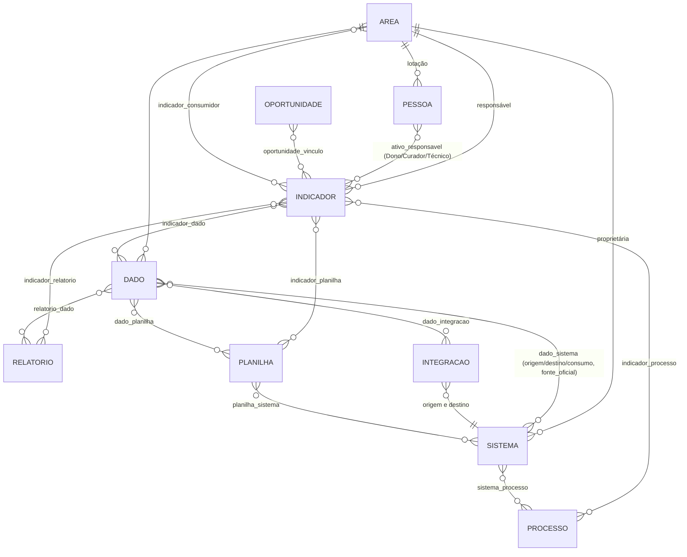

# Modelo de Dados — J. Mendes DataMap (v0.1)

Banco: **Cloudflare D1 (SQLite)**. Scripts: `db/migrations/0001..0003`. Issue #3.
Princípio: **só metadados** (planilha guarda *referência* de localização, nunca conteúdo).

## 1. Diagrama (núcleo)

## 2. Tabelas

| Grupo | Tabelas |
|---|---|
| Configuração | `config_lista`, `config_parametro` |
| Organização | `area` (Gerência→Área via `parent_id`), `pessoa`, `pessoa_perfil` |
| Ativos | `indicador`, `dado`, `sistema`, `processo`, `relatorio`, `planilha`, `integracao`, `regra` |
| Relacionamentos | `indicador_dado`, `indicador_consumidor`, `indicador_relatorio`, `indicador_processo`, `indicador_planilha`, `dado_sistema`, `dado_planilha`, `dado_integracao`, `relatorio_dado`, `planilha_sistema`, `sistema_processo`, `ativo_responsavel`*, `regra_vinculo`* |
| Governança | `revisao`, `workflow_evento`, `recertificacao`, `alerta`, `auditoria` |
| Backlog (V2) | `oportunidade`, `oportunidade_vinculo`* |
| Busca | `busca_fts` (FTS5, sem acento) |
| Views | `vw_grafo_nos`, `vw_grafo_arestas`, `vw_dashboard_resumo`, `vw_vencidos` |

\* polimórficas (`tipo_ativo` + `ativo_id`), **sem FK** para o ativo — integridade validada na API (ADR-015). Necessário para uma única tabela de responsáveis servir a todos os tipos.

Colunas comuns a todo ativo: `status` (Rascunho→Submetido→Em Revisão→Devolvido→Aprovado→Publicado), `revisao`, `ativo`, `freq_recertificacao`, `ultima_revisao`, `proxima_revisao`, auditoria de criação/atualização.

## 3. Onde cada regra é garantida

| Regra | Garantia |
|---|---|
| RN-IND-001/002 nome único por área | Índice único `(area_id, nome NOCASE)` ✔ testado |
| RN-IND-007 consumidor não repetido | PK composta |
| RN-IND-003/004/005 (área, responsável, ≥1 dado) | API **na submissão** (AV-08) |
| RN-DAD-001..004 (Dono, Curador, criticidade, LGPD) | API na submissão; LGPD ativável por `exigir_lgpd_na_submissao` (AV-05) |
| RN-SIS-001/002 | API na submissão |
| RN-WKF-001/002 (só Dono aprova, só Curador submete) | API (papel em `ativo_responsavel` + `pessoa_perfil`) |
| RN-WKF-003 nova revisão ao editar publicado | API cria `revisao` + incrementa `revisao`; `revisao` imutável por trigger |
| RN-REC-001..004 | Cron Trigger gera `alerta` (30/15/5, único por destinatário); `vw_vencidos` |
| Auditoria | `auditoria` append-only (triggers bloqueiam UPDATE/DELETE) ✔ testado |

## 4. Mapa Corporativo

`vw_grafo_arestas` unifica todas as relações (origem, destino, relação). A API navega de forma **não-direcionada** com profundidade limitada (CTE recursiva, testada).
**Achado:** `AREA` e `PESSOA` são nós-hub: expandir através deles traz ativos sem relação direta (ex.: um processo só por estar na mesma área). Regra da API: **não atravessar AREA/PESSOA** durante a expansão; eles aparecem como folhas e só expandem por clique explícito.

## 5. Dados semente

`0003` contém **apenas** o que está na documentação; `0004` traz as listas **propostas** (AV-25): categorias de sistema (ERP, ALFRESCO, HCM), frequências de recertificação, 8 categorias de oportunidade e parâmetros (alertas 30/15/5). Nada além disso foi inventado.

## 6. A Validar (novos)

| ID | Item |
|---|---|
| AV-25 | **Resolvido por delegação (26/11/2026):** valores propostos em `0004_seed_listas_propostas.sql` (criticidade, frequência, LGPD, confidencialidade, qualidade, confiabilidade, tipo de consumo, tipo de relatório, ciclo de vida). Revisar no workshop de validação com Segurança/Privacidade |
| AV-26 | Unicidade de Dado, Sistema e Planilha (BRD só define para Indicador) |
| AV-27 | Cardinalidade Processo↔Dado: BRD exige 1 processo por dado; um dado pode servir a vários processos? |
| AV-28 | Regra (premissa/exceção) do TAP não está no BRD: confirmar se entra no MVP |
| AV-24 | Testar D1 com carga realista (limites do banco, CTE do grafo) — POC pendente |
